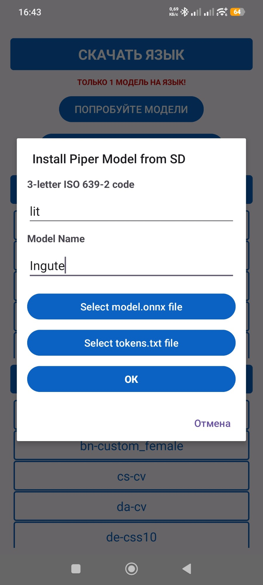
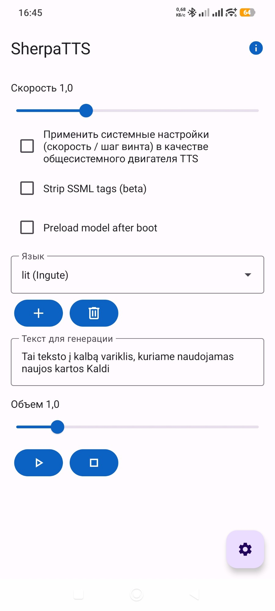
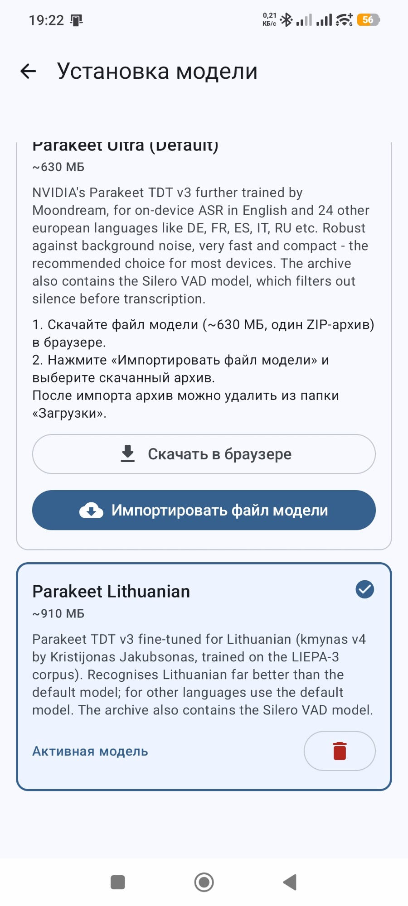
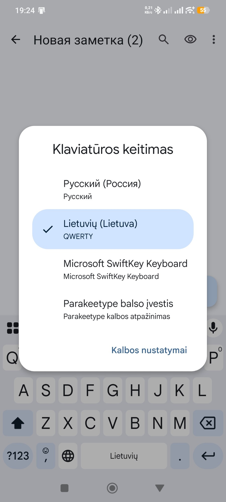
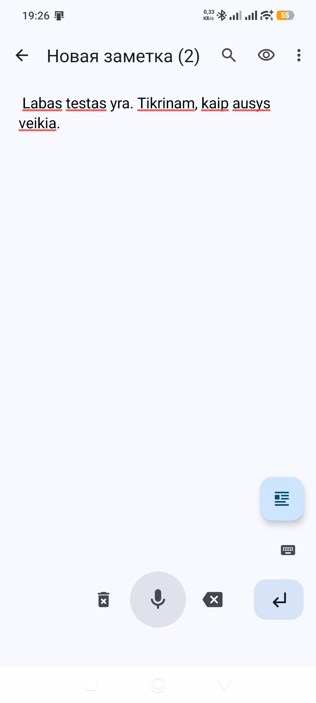
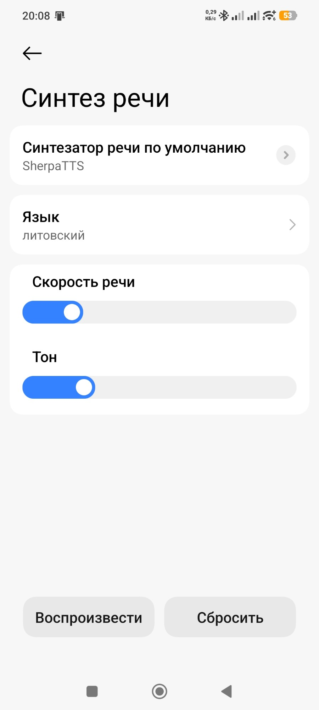
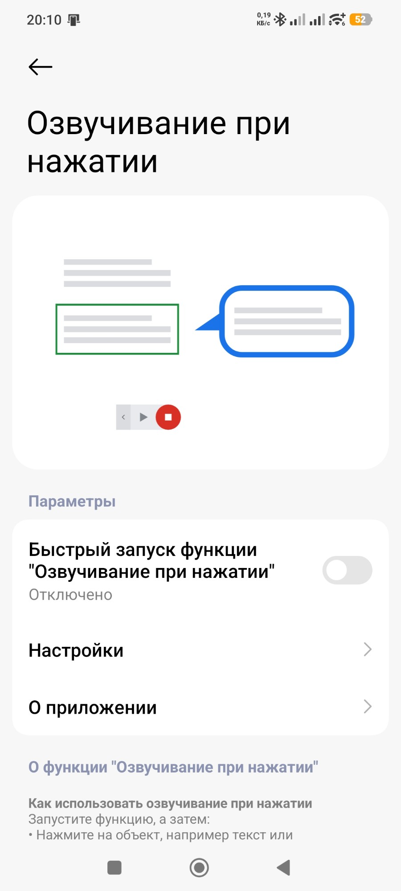
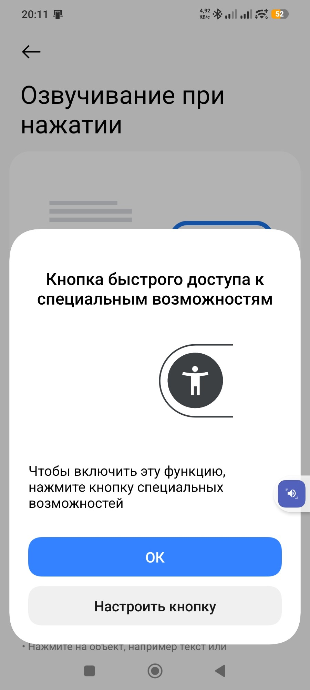

# Android LT — lietuviškas balsas ir ausys Android telefonui


Ingutė, lietuviškas sintetinis balsas, tavo Android telefone. Veikia be interneto. Telefonas ją
naudoja visur, kur moka skaityti garsiai: „Teksto į kalbą“ nustatymuose, ekrano skaitytuve,
knygų ir straipsnių skaityklėse.

Nuo 1.1.0 ir **ausys**: kalbi į telefoną lietuviškai, o tekstas atsiranda bet kuriame teksto
lauke. Irgi be interneto (skyrius [„Ausys“](#ausys-diktavimas-lietuviškai-parakeetype)).

**Jau įdiegei, bet nežinai, ką toliau?** → [Kaip naudotis kasdien](#kaip-naudotis-kasdien)

*Puslapis: https://robertasta.github.io/android-lt/ · In English: [README_EN.md](README_EN.md)*

## Kas čia yra

- **Ingutės balsas** sherpa-onnx formatu (`lt_LT-ingute-medium.onnx`, 63 MB) ir **`tokens.txt`**
  su „s“ pataisa: be jos telefone dingsta daug „s“ garsų („pasiimk skėtį“ skamba kaip „paimk kėtį“).
- **`lt_dict`** — lietuvių eSpeak NG žodynas su kirčio vieta 189 tūkst. žodžių formų. Be jo
  telefonas kirtį spėja ir maždaug pusėje daugiaskiemenių žodžių suklysta: *dãbar, lãbai, Lietùvos*
  vietoje *dabar̃, labaĩ, Lietuvõs*.
- **Ausys** (`parakeet-lt-kmynas-int8.zip`, 955 MB) — lietuviškas kalbos atpažinimo modelis
  balso klaviatūrai Parakeetype.

Balsą groja nemokama atviro kodo programa **SherpaTTS**. Jos šis paketas neturi — ją reikia
įsidiegti atskirai (žr. 1 žingsnį).

## Kaip įdiegti (apie 10 min.)

1. **Įsidiek SherpaTTS iš F-Droid** — Google Play'uje jos **nėra** (paieška ten rodo kitas,
   reklamines programas).
   Failas: https://f-droid.org/repo/org.woheller69.ttsengine_34.apk (versija 3.4, 91 MB).
   Tikroji programa vadinasi **SherpaTTS**, paketas `org.woheller69.ttsengine`, jokių reklamų.
2. **Parsisiųsk į telefoną** iš [Release](https://github.com/RobertasTa/android-lt/releases/latest)
   du failus: `lt_LT-ingute-medium.onnx` ir `tokens.txt`.
3. **SherpaTTS** → „INSTALL PIPER MODEL FROM SD“:
   kalbos kodas `lit`, pavadinimas `Ingute`, modelis — `lt_LT-ingute-medium.onnx`,
   tokens — `tokens.txt` → OK.
4. **Telefono nustatymuose** → „Teksto į kalbą išvestis“ → variklis **SherpaTTS**, kalba
   **lietuvių** → „Klausyti pavyzdžio“.

Čia Ingutė jau kalba. Kirčius kol kas dėlioja eSpeak NG — 5 žingsnis juos sutvarko.

| | |
|---|---|
|  |  |

### 5. Kirčiai (per kompiuterį)

Naujesni Android'ai (išbandyta su 15) neleidžia failų tvarkyklei rašyti į kitų programų aplankus,
todėl `lt_dict` dedamas per kompiuterį su `adb`
([Google platform-tools](https://developer.android.com/tools/releases/platform-tools)).

1. Telefone: Nustatymai → Apie telefoną → 7 kartus paspausk „Versijos numerį“ (Xiaomi — „OS
   versija“; paklaus telefono atrakinimo kodo) → kūrėjo režimas →
   kūrėjo nustatymuose įjunk **„USB derinimas“** → prijunk laidu ir patvirtink leidimą telefone.
2. Kompiuteryje (aplanke, kur yra parsisiųstas `lt_dict` ir `adb`):

```
adb shell md5sum /sdcard/Android/data/org.woheller69.ttsengine/files/espeak-ng-data/lt_dict
```

Turi būti `5426503daf0a29836d0f168d38b38581` (originalus SherpaTTS 3.4 žodynas). **Jei kitoks —
nekeisk**: tavo SherpaTTS versija kita, o šis `lt_dict` sudarytas jos 3.4 versijai.

```
adb shell cp /sdcard/Android/data/org.woheller69.ttsengine/files/espeak-ng-data/lt_dict /sdcard/Android/data/org.woheller69.ttsengine/files/espeak-ng-data/lt_dict_orig
adb push lt_dict /sdcard/Android/data/org.woheller69.ttsengine/files/espeak-ng-data/lt_dict
adb shell am force-stop org.woheller69.ttsengine
```

Atidaryk SherpaTTS ir paklausyk: „Dabar labai gera diena, nes Lietuvos rinktinė laimėjo.“
Po to USB derinimą gali išjungti. Grąžinti: tą patį aplanką, `lt_dict_orig` → `lt_dict`.
Iš naujo įdiegus SherpaTTS ar išvalius jos duomenis, 5 žingsnį reikia kartoti.

## Ką rodo matavimai

Lietuviškas kalbos atpažinimo modelis klausė 12 kasdienių sakinių (be skaičių):

| | žodžių klaidų |
|---|---|
| Ingutė per SherpaTTS be pataisų | 7,7 % |
| + „s“ pataisa (`tokens.txt`) | 4,4 % |
| + kirčiai (`lt_dict`) | 1,1 % |

Kirčio vieta, palyginus su kirčių žodynu (LIEPA tekstai, 19 943 daugiaskiemeniai žodžiai):
eSpeak NG be šio žodyno — 53,4 %, su juo — 99,3 %. Išbandyta Xiaomi 12T Pro, Android 15,
SherpaTTS 3.4.

## Ribos

- Skaičius ir santrumpas skaito eSpeak NG pats („15:25 val.“ gali skambėti keistai).
- Perduodama tik kirčio vieta, ne priegaidė (tvirtapradė / tvirtagalė).
- Apie 9 % žodžių žodyne nėra — jiems kirtį spėja eSpeak NG.
- `lt_dict` sudarytas SherpaTTS 3.4 (sherpa-onnx 1.13) — kitai versijai pirmiau patikrink md5.
- Tai sintetinis balsas: natūralus, bet ne žmogus.

## Ausys: diktavimas lietuviškai (Parakeetype)

[Parakeetype](https://github.com/theScrabi/Parakeetype) yra atviro kodo balso klaviatūra
Android telefonui (F-Droid). Kalbą ji atpažįsta pačiame telefone ir prie interneto
nesijungia. Jos numatytasis modelis lietuviškai girdi prastai, o `parakeet-lt-kmynas-int8.zip`
duoda jai lietuviškas ausis.

| žodžių klaidų dalis | FLEURS (986 sakiniai) | trumpos komandos (127) |
|---|---|---|
| Parakeetype numatytasis modelis (Parakeet Ultra) | 27,1 % | 80,4 % |
| su šiomis ausimis | 10,6 % | 17,0 % |

Matuota kompiuteryje, tiksliai atkartojant Parakeetype atpažinimo kelią; Roberto telefone
(Xiaomi 12T Pro, Android 15) išbandyta gyvai.

**Būsena (2026-10-29).** Kad F-Droid Parakeetype priimtų šį archyvą, jos autorius turi sujungti
mūsų pasiūlymą [theScrabi/Parakeetype#1](https://github.com/theScrabi/Parakeetype/pull/1).
Kol jis nesujungtas, programą su lietuvišku modeliu galima susikompiliuoti pačiam
(„Pasidaryk pats“ žemiau).

### Kaip įdiegti

1. **Parakeetype**: iš F-Droid, kai pasiūlymas bus priimtas, arba susikompiliuota pačiam.
2. **Parsisiųsk į telefoną** `parakeet-lt-kmynas-int8.zip` (955 MB) iš
   [Release](https://github.com/RobertasTa/android-lt/releases/latest).
3. **Parakeetype** pagrindiniame lange įjunk klaviatūrą ir leisk mikrofoną. Prie „Modelis
   neįdiegtas“ spausk „Įdiegti“, slink žemyn iki kortelės **Parakeet Lithuanian** →
   „Importuoti modelio failą“ → archyvas. Programa patikrina visų failų sumas; po to archyvą
   galima ištrinti.
4. Toje pačioje kortelėje — „Nustatyti kaip aktyvų“.
5. **Diktuok**: atidaryk bet kurį teksto lauką (pvz., užrašus) ir perjunk klaviatūrą į
   Parakeetype. Gboard'e ilgai laikyk 🌐 gaubliuką ir pasirink „Parakeetype balso įvestis“.
   Laikyk didelį mikrofono mygtuką ir kalbėk. Pirmą kartą modelis kelias sekundes kraunasi.
6. **Atgal į įprastą klaviatūrą** — mažas klaviatūros ženkliukas dešinėje, virš Enter mygtuko.

| | | |
|---|---|---|
|  |  |  |

### Pasidaryk pats (kol pasiūlymas nesujungtas)

Reikia kompiuterio su Java 17 ar naujesne ir Android SDK: [Android Studio](https://developer.android.com/studio)
arba Google command-line tools (`android sdk install "platforms;android-37.0" "build-tools;37.0.0"`).
Pirmas kompiliavimas parsisiunčia apie 1 GB.

```
git clone -b add-lithuanian-model https://github.com/RobertasTa/Parakeetype.git
cd Parakeetype
./gradlew assembleDebug
```

Windows'e — `gradlew assembleDebug`. Android SDK vietą nurodyk `local.properties` faile
(`sdk.dir=...`) arba `ANDROID_HOME` kintamuoju. Gautą `app/build/outputs/apk/debug/app-debug.apk`
nukopijuok į telefono „Download“ ir paspausk failų tvarkyklėje (Xiaomi be Mi paskyros neleidžia
diegti per `adb install`). Jei jau turi Parakeetype iš F-Droid, pirma ją pašalink: skirtingai
pasirašytos programos viena kitos neatnaujina. Kai pasiūlymas bus priimtas, savo versiją pašalink
ir įsidiek F-Droid.

### Ausų ribos

- Tik lietuvių kalba. Kitoms kalboms rinkis numatytąjį modelį (vienu metu veikia vienas).
- Telefone užima apie 910 MB; Parakeetype reikia Android 12 ar naujesnio.
- Trumpose komandose klysta maždaug kas šeštą žodį.

## Kaip naudotis kasdien

Įdiegti dar nereiškia, kad telefonas pats pradės kalbėti ar klausyti. Čia — ką padaryti vieną
kartą ir kaip paskui naudotis. Meniu pavadinimai skirtinguose telefonuose šiek tiek skiriasi,
todėl paprasčiausia juos rasti **telefono nustatymų paieškoje** (didinamasis stiklas viršuje).
Ekranai — iš Xiaomi telefono rusiška kalba.

### Kad telefonas skaitytų Ingutės balsu

**1. Padaryk Ingutę telefono balsu** (vieną kartą)

Nustatymų paieškoje įrašyk „teksto į kalbą“ (rusiškai „синтез“, angliškai „text-to-speech“).

- **Numatytasis variklis** (rusiškai „Синтезатор речи по умолчанию“) → pasirink **SherpaTTS**.
  Android parodys perspėjimą, kad variklis „gali rinkti tekstą“: jį rodo kiekvienam ne Google
  balsui. SherpaTTS tekstą apdoroja pačiame telefone → spausk **OK**.
- **Kalba** („Язык“) → **lietuvių**. Jei čia lieka „sistemos kalba“, o telefonas ne lietuviškas,
  mygtukai pilki ir niekas nekalba.
- **Klausyti pavyzdžio** („Воспроизвести“) — turi prabilti Ingutė. Greitį keisk čia pat.

**2. Kad perskaitytų bet kokį tekstą ekrane: SMS, laišką, straipsnį** (vieną kartą)

Nustatymų paieškoje įrašyk „Select to Speak“ (rusiškame telefone „озвуч“ →
„Озвучивание при нажатии“). Tai Google funkcija, ji yra daugumoje telefonų su Google Play.

- Įjunk jungiklį. Android paprašys leidimo matyti ekraną — be jo funkcija negalėtų perskaityti
  teksto → **Leisti** („Разрешить“).
- Ekrano krašte atsiras mažas mėlynas mygtukas. Jei klaus, kaip jį nustatyti, — nieko nekeisk,
  spausk **OK**.

**Kasdien:** atsidaryk tekstą → paspausk mėlyną mygtuką → **paliesk pastraipą**, ir Ingutė ją
perskaitys (arba ▶ — skaitys visą ekraną iš eilės, ■ — sustabdo). Mygtuką galima nutempti pirštu
kitur, jei trukdo.

| | | |
|---|---|---|
|  |  |  |

### Kad telefonas rašytų, ką sakai (ausys)

Kai Parakeetype su lietuvišku modeliu jau įdiegta (skyrius „Ausys“ aukščiau):

1. Atsidaryk vietą, kur rašai: SMS, užrašus, paiešką.
2. **Perjunk klaviatūrą į Parakeetype.** Gboard'e ilgai laikyk 🌐 gaubliuką → „Parakeetype balso
   įvestis“. Kitose klaviatūrose ieškok mažo klaviatūros ženkliuko ekrano apačioje.
3. **Laikyk didelį mikrofono mygtuką ir kalbėk.** Atleidus tekstas atsiranda; taškus, kablelius ir
   didžiąsias raides programa sudeda pati.
4. **Atgal į įprastą klaviatūrą** — mažas klaviatūros ženkliukas dešinėje, virš Enter mygtuko.

### Nesiseka? Nebijok klausti

Pasiklydai ar telefonas rodo ne tai, kas čia parašyta? Atsidaryk bet kurį DI pokalbį (ChatGPT,
Claude, Gemini) ir įklijuok:

`Perskaityk https://raw.githubusercontent.com/RobertasTa/android-lt/main/AI_CONSULTANT_BRIEF.md ir padėk man su Android LT.`

Tada parašyk, kas neišeina, ir pridėk ekrano nuotrauką. Tas DI žino visus šiuos žingsnius ir
dažniausias klaidas, o kalbėsis su tavimi lietuviškai.

## Licencijos

- **Balsas** (`lt_LT-ingute-medium.onnx`, `tokens.txt`) — NewGenLTU Open RAIL-D 1.0:
  naudoti galima laisvai ir nemokamai, komercinio naudojimo nedraudžia, galioja naudojimo
  apribojimai; perduodant toliau kartu perduoti [LICENSE-VOICE](LICENSE-VOICE) ir nurodyti kilmę.
  Ingutė išaugo iš Reginutės modelio, mūsų Python įrankiais.
- **`lt_dict`** ir jo šaltiniai (`espeak-ng-lt/`) — GPL-3.0 (eSpeak NG duomenys). Kirčių vietos
  sudarytos iš dviejų CC BY 4.0 darbų — žr. [THIRD_PARTY.md](THIRD_PARTY.md).
- **Ausys** (`parakeet-lt-kmynas-int8.zip`) — CC BY 4.0: NVIDIA Parakeet TDT 0.6B v3, lietuviškai
  apmokytas Kristijono Jakubsono („kmynas v4“, LIEPA-3). Mūsų pakeitimai surašyti archyvo
  `NOTICE.txt`. Archyve esantis Silero VAD — MIT. Parakeetype — atskira programa (GPL-3.0).
- Šio repozitorijos tekstai — GPL-3.0 ([LICENSE](LICENSE)).

## Ačiū

[SherpaTTS](https://github.com/woheller69/ttsengine) (woheller69), [sherpa-onnx](https://github.com/k2-fsa/sherpa-onnx)
(k2-fsa), [eSpeak NG](https://github.com/espeak-ng/espeak-ng), [Piper](https://github.com/OHF-Voice/piper1-gpl)
ir Michaelui Hansenui; **LIEPA** garsyno kūrėjams (Vilniaus universitetas) ir **Arūnui Smaliukui**
už `g2p-lt-lexicon`; [Parakeetype](https://github.com/theScrabi/Parakeetype) (theScrabi),
**Kristijonui Jakubsonui** už lietuvišką Parakeet („kmynas“) ir NVIDIA už Parakeet.

## Nesiseka?

Įklijuok į bet kurį DI pokalbį: `Perskaityk https://raw.githubusercontent.com/RobertasTa/android-lt/main/AI_CONSULTANT_BRIEF.md ir padėk man su Android LT.`
Klausimai ir pastebėjimai — [Issues](https://github.com/RobertasTa/android-lt/issues).

---

Sukurta naudojant DI: paketą ruošė ir matavo Claude (Anthropic) kartu su Robertu; išbandyta
Roberto telefone; baneris sukurtas naudojant DI. Kitos mūsų dovanos: [Skaityklė](https://github.com/RobertasTa/skaitykle) (tekstas
į mp3), [Diktuoklė](https://github.com/RobertasTa/diktuokle) (diktavimas balsu) —
[visos](https://github.com/RobertasTa).
