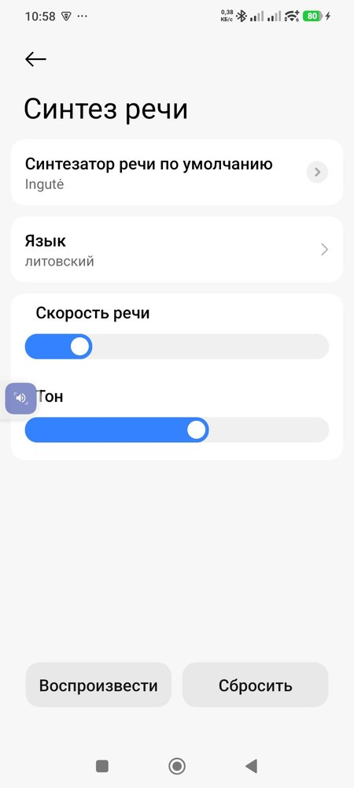
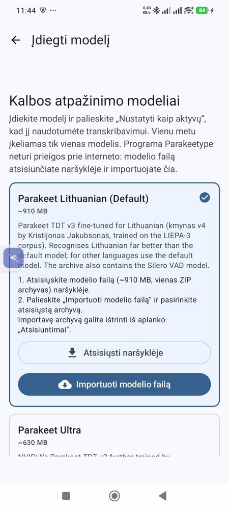
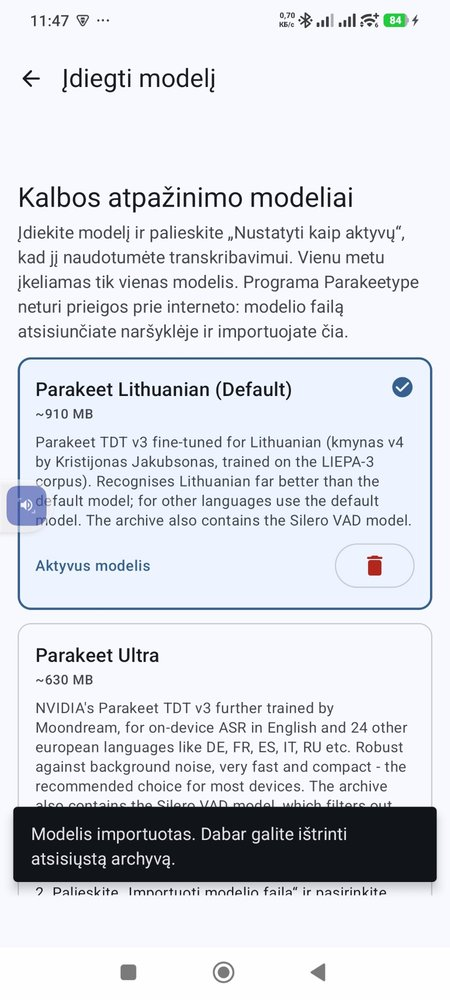
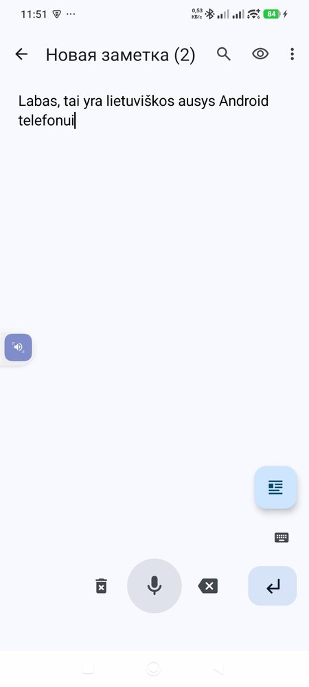
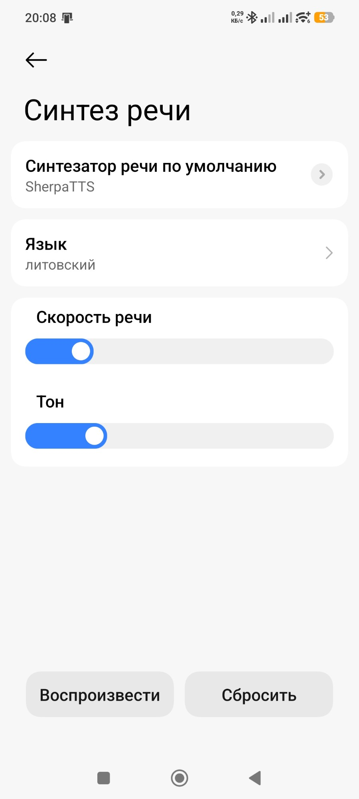
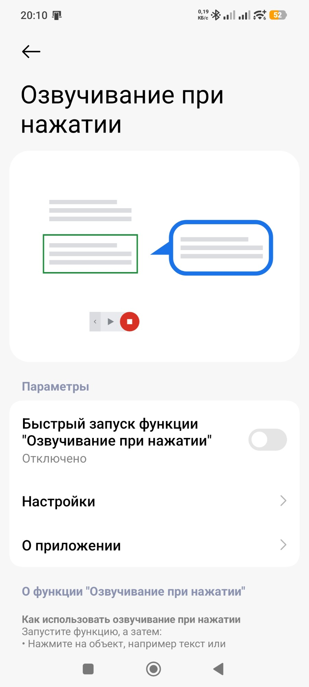
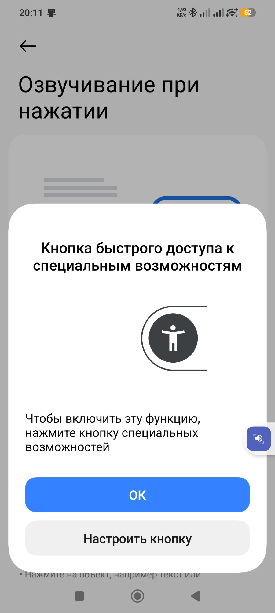

# Android LT: a Lithuanian voice and ears for Android phones


Ingutė, a Lithuanian synthetic voice, on your Android phone, offline. The phone uses it wherever
it can read aloud: the text-to-speech settings, the screen reader, book and article readers.

There are **ears** too: speak Lithuanian to the phone and the text appears in any text field:
SMS, notes, the ChatGPT, Claude or Gemini app. Also offline (see [Ears](#ears-lithuanian-dictation-parakeetype)).

**Since 1.2.0 there are two ready-made apps:** download, install, done. No F-Droid, no cable, no
computer → [Installing](#installing-about-5-minutes)

**Installed it but not sure what next?** → [Everyday use](#everyday-use)

*Page: https://robertasta.github.io/android-lt/en/ · Lietuviškai: [README.md](README.md)*

## What is here

- **`Ingute-1.0.apk`** (151 MB): the app "Ingutė", a Lithuanian voice for the phone. The voice, the
  "s" fix and the stress dictionary are already inside; once installed it becomes the phone's voice
  by itself. It is [SherpaTTS](https://github.com/woheller69/ttsEngine) 3.4 (woheller69) with our
  Lithuanian additions ([source](https://github.com/RobertasTa/ttsEngine/tree/ingute)).
- **`Parakeetype-LT-0.5.0-lt2.apk`** (59 MB): the voice keyboard "Parakeetype LT" for Lithuanian
  dictation. It is [Parakeetype](https://github.com/theScrabi/Parakeetype) (theScrabi) with the
  Lithuanian model first and as the default ([source](https://github.com/RobertasTa/Parakeetype/tree/lt-build)).
  It has no internet permission.
- **Ears** (`parakeet-lt-kmynas-int8.zip`, 955 MB): the Lithuanian speech recognition model for that
  keyboard; the app shows where to download it.
- For advanced users, separately: **Ingutė** in sherpa-onnx format (`lt_LT-ingute-medium.onnx`,
  63 MB), a **`tokens.txt`** with an "s" fix (eSpeak NG writes Lithuanian /s/ as `ʂ` in many
  positions, a symbol the voice hardly learned, so "pasiimk skėtį" comes out as "paimk kėtį"), and
  **`lt_dict`**, the eSpeak NG dictionary with the stressed syllable for 189,000 word forms (without
  it the stress is wrong in about half of the multi-syllable words).

Both apps are signed with our key, certificate SHA-256
`8679aa5fbfd9f9f96d53ba761e72c9b0f7a361ffdc8493e33bb905e077afaf7f`; file hashes are in `SHA256SUMS.txt`
in the release.

## Installing (about 5 minutes)

Android 10 or newer (Android 12 for the ears). Both files are in the
[release](https://github.com/RobertasTa/android-lt/releases/latest).

### Voice: "Ingutė"

1. **Download** `Ingute-1.0.apk` to the phone and tap it (in the browser or a file manager, in the
   Download folder). The phone asks whether to allow installing apps from this source: **allow** it.
2. **Install.** No need to open the app: Ingutė installs herself.
3. **Phone settings** → "Text-to-speech output" → engine **Ingutė**, language **Lithuanian** →
   "Listen to an example". Ingutė speaks, with the stress already right.

### Ears: "Parakeetype LT"

1. **Download and install** `Parakeetype-LT-0.5.0-lt2.apk`. If Google Play Protect offers to scan
   the app, tap **Scan**, then **Install** (for us it answered that the app looks safe).
2. **Open** it, allow the microphone, and next to "Model not installed" tap **Install**.
3. On the **"Parakeet Lithuanian (Default)"** card: **Download in browser** (955 MB, Wi-Fi is better).
   When it has downloaded: **Import model file** → `parakeet-lt-kmynas-int8.zip`. A minute later the
   card says **Active model**; you can delete the archive.
4. On the start screen, next to "Keyboard not enabled" → **Open settings** → turn Parakeetype on.
   Android warns that the keyboard "may collect everything you type": it says this for every
   keyboard, and this one has no internet permission, so the text never leaves the phone → **OK**.
5. **Dictate**: in any text field long-press 🌐 in Gboard → **Parakeetype Voice Input**, hold the big
   microphone button and speak.

| | | | |
|---|---|---|---|
|  |  |  |  |

The app screenshots are in Lithuanian, the system dialogs in Russian (the phone's language).

<details>
<summary><b>Advanced: the voice through SherpaTTS from F-Droid</b> (without our app, about 10 minutes)</summary>

1. **Install SherpaTTS from F-Droid.** It is not on Google Play; searching there shows other,
   ad-supported apps.
   File: https://f-droid.org/repo/org.woheller69.ttsengine_34.apk (version 3.4, 91 MB).
   The right app is called **SherpaTTS**, package `org.woheller69.ttsengine`, no ads.
2. **Download to the phone** from the
   [release](https://github.com/RobertasTa/android-lt/releases/latest):
   `lt_LT-ingute-medium.onnx` and `tokens.txt`.
3. **SherpaTTS** → "INSTALL PIPER MODEL FROM SD": language code `lit`, name `Ingute`,
   model `lt_LT-ingute-medium.onnx`, tokens `tokens.txt` → OK.
4. **Phone settings** → "Text-to-speech output" → engine **SherpaTTS**, language
   **Lithuanian** → "Listen to an example".

Ingutė speaks now. Stress is still placed by eSpeak NG; step 5 fixes that.

### 5. Stress (needs a computer)

Recent Android versions (tested on 15) do not let file managers write into another app's
folder, so `lt_dict` goes in through `adb` from a computer
([Google platform-tools](https://developer.android.com/tools/releases/platform-tools)).

1. On the phone: Settings → About phone → tap the build number 7 times (developer mode; the
   phone asks for its unlock code) → in developer options turn on **USB debugging** → connect
   the cable and allow it on the phone.
2. On the computer, in the folder with the downloaded `lt_dict`:

```
adb shell md5sum /sdcard/Android/data/org.woheller69.ttsengine/files/espeak-ng-data/lt_dict
```

It must print `5426503daf0a29836d0f168d38b38581` (the dictionary of SherpaTTS 3.4). **If it is
different, stop**: your SherpaTTS version differs and this `lt_dict` was built for 3.4.

```
adb shell cp /sdcard/Android/data/org.woheller69.ttsengine/files/espeak-ng-data/lt_dict /sdcard/Android/data/org.woheller69.ttsengine/files/espeak-ng-data/lt_dict_orig
adb push lt_dict /sdcard/Android/data/org.woheller69.ttsengine/files/espeak-ng-data/lt_dict
adb shell am force-stop org.woheller69.ttsengine
```

Open SherpaTTS and listen to "Dabar labai gera diena, nes Lietuvos rinktinė laimėjo."
You can switch USB debugging off afterwards. To undo, rename `lt_dict_orig` back to `lt_dict`.
Reinstalling SherpaTTS or clearing its data undoes step 5.

</details>

## Measurements

A Lithuanian speech recognition model listened to 12 everyday sentences (no numbers):

| | word errors |
|---|---|
| Ingutė in SherpaTTS, no fixes | 7.7 % |
| + "s" fix (`tokens.txt`) | 4.4 % |
| + stress (`lt_dict`) | 1.1 % |

Stressed syllable compared with the stress dictionary on LIEPA texts (19,943 multi-syllable
words): eSpeak NG alone 53.4 %, with this dictionary 99.3 %. Tested on a Xiaomi 12T Pro,
Android 15, SherpaTTS 3.4.

## Limits

- Numbers and abbreviations are read by eSpeak NG itself ("15:25 val." may sound odd).
- Only the stressed syllable is set, not the Lithuanian pitch accent.
- About 9 % of words are not in the dictionary; eSpeak NG guesses those.
- `lt_dict` was built for SherpaTTS 3.4 (sherpa-onnx 1.13); check the md5 first on other versions.
- It is a synthetic voice: natural, but not a person.

## Ears: Lithuanian dictation (Parakeetype)

[Parakeetype](https://github.com/theScrabi/Parakeetype) is an open-source voice keyboard for
Android (F-Droid). It recognises speech on the phone and never goes online. Its default model
hears Lithuanian poorly; `parakeet-lt-kmynas-int8.zip` gives it Lithuanian ears.

| word error rate | FLEURS (986 utterances) | short commands (127) |
|---|---|---|
| Parakeetype's default model (Parakeet Ultra) | 27.1 % | 80.4 % |
| with these ears | 10.6 % | 17.0 % |

Measured on a PC with a script that follows Parakeetype's recognition path exactly; tested live on
Robertas's phone (Xiaomi 12T Pro, Android 15).

**Installing**: see ["Ears: Parakeetype LT"](#ears-parakeetype-lt) above, our ready-made app. Once
Parakeetype's author merges our proposal [theScrabi/Parakeetype#1](https://github.com/theScrabi/Parakeetype/pull/1),
the F-Droid Parakeetype will offer the Lithuanian model too.

### Build it yourself

You need a computer with Java 17 or newer and the Android SDK: [Android Studio](https://developer.android.com/studio)
or Google's command-line tools (`android sdk install "platforms;android-37.0" "build-tools;37.0.0"`).
The first build downloads about 1 GB.

```
git clone -b lt-build https://github.com/RobertasTa/Parakeetype.git
cd Parakeetype
./gradlew assembleDebug
```

On Windows: `gradlew assembleDebug`. Point to the Android SDK with `sdk.dir=...` in
`local.properties` or the `ANDROID_HOME` variable. Copy the resulting
`app/build/outputs/apk/debug/app-debug.apk` to the phone's Download folder and tap it in a file
manager (Xiaomi phones refuse `adb install` without a Mi account). If you already have
"Parakeetype LT" from our release, uninstall it first: apps signed with different keys cannot
update each other. The voice app's source is branch [`ingute`](https://github.com/RobertasTa/ttsEngine/tree/ingute);
it builds the same way.

### Limits of the ears

- Lithuanian only. For other languages pick the default model (one model is active at a time).
- About 910 MB on the phone; Parakeetype needs Android 12 or newer.
- On short commands it gets roughly one word in six wrong.

## Everyday use

Installing does not yet make the phone speak or listen. Here is what to set up once and how to use
it afterwards. Menu names differ a little between phones, so the easiest way to find them is the
**search box in the phone's settings**. The screenshots are from a Xiaomi phone set to Russian.

### Make the phone read with Ingutė's voice

**1. Make Ingutė the phone's voice** (once)

Search the settings for "text-to-speech".

- **Preferred engine** → **Ingutė** (or **SherpaTTS** if you took the advanced route). Android warns
  that the engine "may collect text"; it shows this for every voice that is not Google's. Ingutė
  processes the text on the phone → **OK**.
- **Language** → **Lithuanian**. If it stays at "system language" on a phone that is not in
  Lithuanian, the buttons are grey and nothing speaks.
- **Play** (listen to an example): Ingutė should speak. The speed slider is right there.

**2. Have any text on the screen read aloud: SMS, email, articles** (once)

Search the settings for "Select to Speak". It is a Google feature present on most phones with
Google Play.

- Turn the switch on. Android asks for permission to see the screen; without it the feature could
  not read the text → **Allow**.
- A small blue button appears at the edge of the screen. If you are asked how to set it up, leave
  it as it is and tap **OK**.

**Every day:** open the text → tap the blue button → **tap a paragraph** and Ingutė reads it (or ▶
to read the whole screen, ■ to stop). You can drag the button elsewhere if it is in the way.

| | | |
|---|---|---|
|  |  |  |

### Make the phone type what you say (ears)

Once Parakeetype with the Lithuanian model is installed (see "Ears" above):

1. Open the place where you type: SMS, notes, search.
2. **Switch the keyboard to Parakeetype.** In Gboard, long-press the 🌐 globe → "Parakeetype Voice
   Input". On other keyboards look for a small keyboard icon at the bottom of the screen.
3. **Hold the big microphone button and speak.** When you let go, the text appears; the app adds
   full stops, commas and capital letters itself.
4. **Back to your usual keyboard**: the small keyboard icon on the right, above the Enter key.

### Stuck? Just ask

Lost, or the phone shows something different from this page? Open any AI chat (ChatGPT, Claude,
Gemini) and paste:

`Read https://raw.githubusercontent.com/RobertasTa/android-lt/main/AI_CONSULTANT_BRIEF.md and help me with Android LT.`

Then say what does not work and attach a screenshot. That AI knows all these steps and the usual
mistakes, and it will answer in your language.

## Licences

- **Apps**: GPL-3.0, like their originals. "Ingutė" is SherpaTTS (woheller69) with our changes
  ([source](https://github.com/RobertasTa/ttsEngine/tree/ingute)); "Parakeetype LT" is Parakeetype
  (theScrabi) with our changes ([source](https://github.com/RobertasTa/Parakeetype/tree/lt-build)).
  The voice and dictionary inside "Ingutė" are under the licences below.
- **Voice** (`lt_LT-ingute-medium.onnx`, `tokens.txt`): NewGenLTU Open RAIL-D 1.0. Free of
  charge, commercial use is not prohibited, use restrictions apply; when passing it on, include
  [LICENSE-VOICE](LICENSE-VOICE) and state the origin. Ingutė was grown from the Reginutė model
  with the authors' own Python tools.
- **`lt_dict`** and its sources (`espeak-ng-lt/`): GPL-3.0 (eSpeak NG data). The stress
  positions come from two CC BY 4.0 works; see [THIRD_PARTY.md](THIRD_PARTY.md).
- **Ears** (`parakeet-lt-kmynas-int8.zip`): CC BY 4.0. NVIDIA Parakeet TDT 0.6B v3, fine-tuned for
  Lithuanian by Kristijonas Jakubsonas ("kmynas v4", LIEPA-3). Our changes are listed in the
  archive's `NOTICE.txt`. The Silero VAD inside the archive is MIT. Parakeetype is a separate
  app (GPL-3.0).
- Texts in this repository: GPL-3.0 ([LICENSE](LICENSE)).

## Thanks

[SherpaTTS](https://github.com/woheller69/ttsengine) (woheller69),
[sherpa-onnx](https://github.com/k2-fsa/sherpa-onnx) (k2-fsa),
[eSpeak NG](https://github.com/espeak-ng/espeak-ng), [Piper](https://github.com/OHF-Voice/piper1-gpl)
and Michael Hansen; the creators of the **LIEPA** corpus (Vilnius University) and
**Arūnas Smaliukas** for `g2p-lt-lexicon`; [Parakeetype](https://github.com/theScrabi/Parakeetype)
(theScrabi), **Kristijonas Jakubsonas** for the Lithuanian Parakeet ("kmynas") and NVIDIA for
Parakeet.

## Stuck?

Paste into any AI chat: `Read https://raw.githubusercontent.com/RobertasTa/android-lt/main/AI_CONSULTANT_BRIEF.md and help me with Android LT.`
Questions and feedback: [Issues](https://github.com/RobertasTa/android-lt/issues).

---

Made with AI: Claude (Anthropic) prepared and measured the package together with Robertas;
tested on Robertas's phone; the banner was made with AI. Our other gifts: [Skaityklė](https://github.com/RobertasTa/skaitykle)
(text to MP3), [Diktuoklė](https://github.com/RobertasTa/diktuokle) (voice dictation),
[all of them](https://github.com/RobertasTa).
